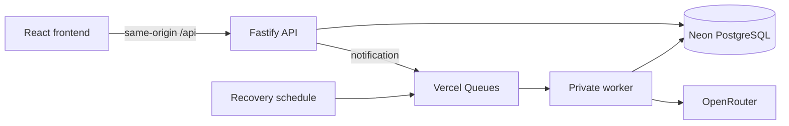

# Architecture

`frontend` owns pages, reusable domain components, hooks and a generated API client. Pages live in named folders with `index.tsx`; page-specific components stay beside the page. UI and domain barrels expose their public components. TanStack Query owns server state, the URL owns shareable filters, and React Router owns navigation.

`backend/modules/api` owns HTTP validation, authentication and responses. `backend/modules/worker` owns execution. Neither imports the other. `backend/common` contains the shared contracts, repositories, knowledge adapter and queue transport. `backend/migrations` is applied explicitly before starting a changed release; request handlers do not create tables.

## Transactions and failure boundaries

A preparation transaction creates a run, job and history item. Queue publishing happens after commit. If publishing fails, the durable job still exists and the scheduled recovery consumer republishes it. Queue delivery is at least once; PostgreSQL claims one lease at a time with an increasing fence. Generation runs outside a transaction. Completion checks the current fence and lease before saving a draft.

A transient provider failure is retried, with at most three claimed attempts. Invalid output is terminal and visible to the reviewer. A crashed worker leaves an expiring lease. Cancellation increments the fence, so a late response cannot become the saved draft. These rules prevent conflicting database effects, not duplicate external billing.

Approval locks the run and saved draft, checks the submitted version, and commits the approved text, history, optional escalation and idempotency receipt together. Editing a newer version while another reviewer approves an older one produces a conflict rather than silently changing the approved response.

## Retrieval and model boundary

The seeded ticket topic selects a small search query; PostgreSQL full-text search selects current articles. The adapter sends the actual customer message and those articles to OpenRouter. It requires structured output and checks that every citation references a current article with an exact quote. Missing knowledge yields an uncited clarification draft. The model does not execute actions, contact customers or write directly to the database.

This is intentionally simpler than embeddings and a general document ingestion pipeline. It makes the review and failure semantics visible without introducing a second storage system. The limitation is that arbitrary imported tickets would require a separate retrieval and evaluation design.

## Pagination and state

Ticket and history endpoints use descending numeric keysets. The first page records an insertion ceiling; later inserts cannot shift the current traversal. Signed cursors bind the workspace and filter (or ticket), and every query applies that workspace. Status membership remains live, so an approval invalidates the relevant list. It is not a frozen snapshot of status changes.

The browser reconnects persisted events and polls an active run as a recovery path. Signing out cancels queries and clears cached data. Responses from an older token cannot populate a new workspace.
