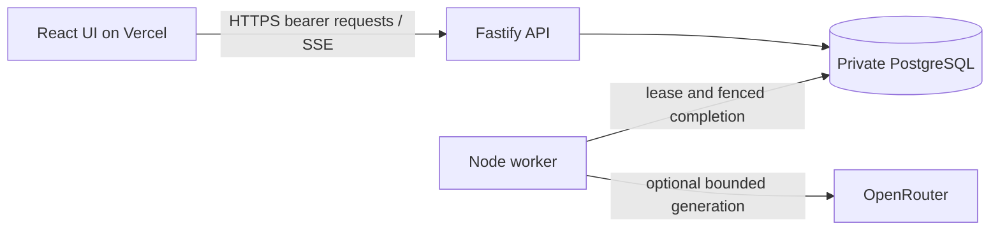

# Architecture

The API owns HTTP validation/authentication and composes application operations. The worker owns durable execution. PostgreSQL owns jobs, sessions, current knowledge revisions, runs, drafts, events, approvals and receipts. The UI is an independent static build; the backend is not a Vercel Function.

## Source boundaries

| Path                           | Responsibility                                                |
| ------------------------------ | ------------------------------------------------------------- |
| `apps/web/src/pages`           | Page composition and user journeys.                           |
| `apps/web/src/components`      | Reusable UI and generated primitives.                         |
| `apps/web/src/hooks`           | Query, session, streaming and interaction state.              |
| `apps/web/src/lib`             | API client, event parsing and UI utilities.                   |
| `apps/api/src/routes`          | HTTP endpoint composition.                                    |
| `apps/api/src/plugins`         | Shared HTTP concerns and documentation wiring.                |
| `apps/api/src/schemas`         | Route request/response schemas.                               |
| `apps/worker/src`              | Worker startup and execution loop.                            |
| `packages/contracts/src`       | Validated shared transport/domain shapes.                     |
| `packages/data/src`            | PostgreSQL repositories and transactions.                     |
| `packages/data/migrations`     | Database migration assets.                                    |
| `packages/knowledge/src`       | Synthetic corpus, retrieval/evidence and generation behavior. |
| `packages/config/src`          | Server environment parsing shared by API/worker/migrator.     |
| `tests/apps`, `tests/packages` | Tests mirroring production ownership.                         |

Packages have explicit exports. Web depends on contracts, not repositories or server configuration. API and worker share packages without importing another app. Configuration and database access stay outside browser bundles. The current structure passed local static, build, database and browser checks; hosted release status is recorded in [status](delivery-status.md).

## Consistency boundaries

Run and job creation commit together. Workers claim leases with increasing fences, perform external work outside the transaction and conditionally commit only their current claim. Persisted per-run events support replay; a final snapshot resolves terminal UI state. Approval serializes the exact saved draft version and records reply/history/escalation plus idempotency outcome atomically.

Ticket/history pagination uses a descending numeric keyset and an insertion ceiling established on the first page. Cursors are authenticated and scoped to workspace and filters/ticket. Status membership remains live; explicit refresh is necessary after relevant mutations. This differs from Feedback Desk's frozen membership model.

See [active hosting decision](decisions/0002-hybrid-hosting.md), [auth](auth-tenancy.md) and [workflows](workflows.md).
