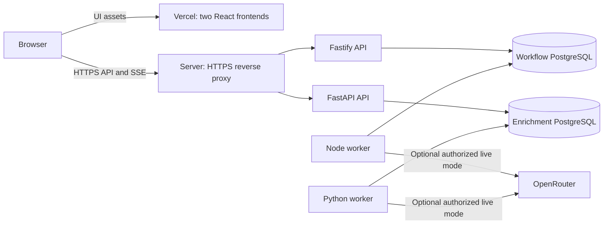

> Implementation update: the approved Support Desk now always connects to the API; the former browser-only adapter is retired. Independent bearer account/demo sessions, exact cursor pagination, and the optional local Compose web profile are implemented. The canonical current behavior and limits are in README.md. OpenRouter is explicitly disabled by default and guarded by a persistent global admission budget. Deployment update (2026-10-10): the Support Desk API, worker and private PostgreSQL are deployed in their isolated Yandex Cloud Docker project. Release `turovnd-workflow:20261010-support.2` is deployed; the migration passed and https://workflow-api.b2p.space/health returned HTTP 200 in deterministic mode. The API remains loopback-published behind the reverse proxy. Public HTTPS backend smoke testing passed: numeric cursor pages without overlap, workspace isolation, persisted queued-to-ready SSE, worker draft generation, versioned edits, approval/idempotent replay, edited history, resolved ticket status and session revocation. Vercel UI deployment remains pending because the requested MCP connection is unavailable; no public UI URL exists yet. Historical design notes below are preserved.

# Hybrid deployment: Vercel UI and Docker backend

Historical planning baseline, 2026-10-09. **Hosting split accepted by the owner.** Current implementation and deployment status is recorded above. This replaces the earlier Vercel Services/Queues proposal. The owner also accepted both product scenarios and the proposed Python style; implementation is authorized.

## Selected topology

Each repository remains independently runnable and deployable.

| Layer | AI Workflow Workbench | Realtime Data Workbench |
| --- | --- | --- |
| UI | React/Vite static build on its own Vercel project | React/Vite static build on its own Vercel project |
| HTTPS entrypoint | Existing compatible reverse proxy, or shared Caddy on the server | Same shared entrypoint, separate API hostname |
| API | Fastify container | FastAPI container |
| Background execution | Separate Node worker container | Separate Python worker container |
| Persistence | PostgreSQL with pgvector when semantic retrieval is enabled | PostgreSQL |
| Isolation | Own Compose project/network, credentials and data volume | Own Compose project/network, credentials and data volume |

Use the owner's existing server. Inspect its current services, ports and resources before provisioning these new stacks. Do not replace an existing reverse proxy or deployed application blindly. Hostnames and the Vercel account/team are not yet known; no example hostname is a real deployment URL.

## Frontend to API

Prefer direct browser requests to the server's HTTPS API, including SSE. Vercel hosts UI assets; backend work does not run in Vercel Functions, Services or Queues. External Vercel rewrites are a possible future alternative, but their documented 120-second proxied-request timeout is an extra constraint and does not establish an unlimited active SSE connection. [Vercel rewrites](https://vercel.com/docs/routing/rewrites), [proxy limits](https://vercel.com/docs/limits#proxied-request-timeout).

Use an explicit public API base URL for each frontend environment. Public `VITE_*` values are embedded in the browser bundle; they must never contain DB credentials, model keys or service tokens. All provider calls and secrets remain server-side. [Vite environment variables](https://vite.dev/guide/env-and-mode).

Allow exact intended UI origins and handle preflight requests. Do not trust every `vercel.app` origin. CORS is not authentication: workspace identity still comes from a validated session or credential. The final session mechanism will be selected with the UI/API contracts, not inferred from hosting alone. [FastAPI CORS](https://fastapi.tiangolo.com/tutorial/cors/).

If cookie sessions are selected, use API host-only secure HttpOnly cookies, explicit credentialed requests and a CSRF/Origin strategy for mutations. Preview URLs on `vercel.app` are cross-site relative to a custom API domain; third-party-cookie policy can block them despite correct CORS. Do not declare cookie-based preview integration solved by adding an allowlist. [MDN CORS](https://developer.mozilla.org/en-US/docs/Web/HTTP/Guides/CORS).

## Preview and production separation

- First UI previews may use a clearly labelled deterministic browser adapter while the real backend is being implemented. Such a preview is a UI review build, not evidence of real database, worker or RAG integration.
- Use separate Vercel Preview/Production environment values. Ordinary previews default to demo mode; an integration preview explicitly targets a separate staging backend/data set.
- A stable staging UI/API pair is the simplest initial integration environment. If dynamic preview integration is later needed, register only known authorized origins and isolate their data/session scope; remove registrations when previews expire.
- Never make every branch preview share production mutation credentials or live model budgets. The production frontend uses the corresponding production API.
- Initial CLI preview deployment does not require making either Git repository public. Public GitHub pushes, profile changes and old-repository changes remain separate actions.

Vercel documents independent development, preview and production environments. Actual project creation, environment setup and deployment remain pending a runnable UI and the selected account/team. [Vercel environments](https://vercel.com/docs/deployments/environments).

## Durable work without a managed broker

The API commits business state and a job row in one database transaction. A continuously running worker polls eligible jobs in bounded batches, claims them with a lease/fencing version, and persists outcomes and retry times. PostgreSQL remains the authoritative job queue. API process failure after commit cannot lose the queued job. An optional wake-up notification is only a latency optimization; polling is the recovery path.

Keep provider calls outside DB transactions. Bound per-call time, output size, attempts, admitted concurrency and batch size. A worker crash may repeat a model request; unique result keys and fenced completion prevent stale or duplicate stored effects. Retain checkpoints, cancellation boundaries, failed-job inspection and explicit retry. Do not claim exactly-once model calls or charges.

No Vercel Queues publish bridge or broker-TTL reconciliation is needed in this topology. Retry scanning, expired-lease recovery and normal job execution run in the worker. Start without Redis, Kafka or a second workflow engine; add infrastructure only for a demonstrated need. An always-running process alone does not make work durable.

## Streaming

SSE uses persisted, commit-consistent event cursors, heartbeat, reconnect and snapshot recovery. Caddy automatically flushes `text/event-stream` responses; do not add `flush_interval -1` casually, as it also affects behavior after downstream disconnection. Verify stream latency, disconnection and cancellation through the actual reverse proxy. No intermediary configuration guarantees an infinite connection. [Caddy streaming](https://caddyserver.com/docs/caddyfile/directives/reverse_proxy#streaming).

Browser service workers still serve the planned offline shell and explicitly selected synthetic snapshots. They do not execute backend jobs or replay approvals while offline. Serverless/Lambda execution is no longer a required demo component; the selected deployment does not need it merely to include the technology.

## Server deployment and operations

Use versioned container images built by CI, named persistent volumes, health checks, restart policies, bounded resource/log usage and graceful worker shutdown. Production containers run packaged code rather than mounting a development source tree. Compose is sufficient for this single-server topology. [Docker production guidance](https://docs.docker.com/compose/how-tos/production/).

Expose HTTPS through the reverse proxy. PostgreSQL and workers stay on private container networks; do not publish DB ports publicly. Each project gets its own database credentials and storage. A shared PostgreSQL instance with separate databases/users is an optional resource-saving choice only after the actual machine is inspected; it must not become a dependency between repository startup paths. [Docker port publishing](https://docs.docker.com/engine/network/port-publishing/).

Before the first server rollout: inspect existing port ownership, confirm available resources and image architecture, arrange server-only secrets and an external backup destination, run migrations with a deliberate owner, and document restoration. A volume survives container replacement but is not a backup. This one server is a common failure domain; high availability is not claimed.

CI must run frontend lint/format/typecheck/build, Python equivalents, unit tests, real PostgreSQL integration tests and browser E2E. Release steps build tagged images, run compatible migrations, update only the relevant Compose project and run API/UI smoke tests. Keep the previous image available for application rollback; database rollback requires its own compatibility/restore plan. No shared-server configuration changes are made before its current state is understood.

## Remaining inputs and next execution steps

1. Completed: scenario/style checkpoint, local implementation and verification, read-only server inspection and domain selection.
2. Completed for Support Desk: isolated backend deployment of `20261010-support.2`, migration and HTTPS readiness check.
3. Completed: public HTTPS backend smoke covering cursor order/isolation, durable SSE, draft editing, approval replay, history and session revocation.
4. Pending: restore the requested Vercel MCP connection and deploy the UI. No public UI URL is available.
5. Connect the deployed UI and verify CORS/session/SSE/recovery before describing the entire hosted product as verified.

The user has selected this topology and requested deployment. Do not ask again for generic approval to use Vercel UI or Docker backend; ask only for genuinely missing destination/access information or a concrete scope-changing action.
